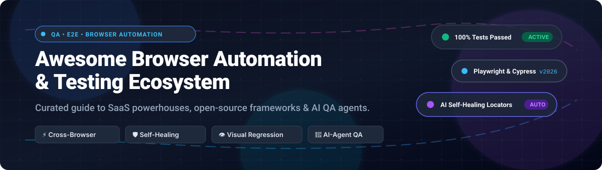

  

# 🌐 Awesome Browser Automation & Testing 🧪

> 🚀 A curated collection of SaaS platforms, open-source testing frameworks, headless browser infrastructure, and next-generation AI-powered QA agents for modern web applications.

  
  
  
  
  
  

---

## 📌 Top Browser Automation & Testing Ecosystem

**Curated List of SaaS Products & Open-Source GitHub Projects**  
*Focused on Cross-Browser Testing, Self-Healing Locators, Headless Runners & Visual Regression Detection*  
📅 **Last updated: October 2026**

This repository tracks notable **SaaS platforms** and **open-source projects** for **Browser Automation & Testing**. These tools enable QA engineers, developers, and SDETs to automate web application testing—from codeless test creation for business teams to code-first frameworks with parallel cloud execution and visual regression validation.

- 🏆 **Enterprise Leaders**: Micro Focus UFT, SmartBear TestComplete, Katalon Studio, Tricentis Tosca, Applitools, and Ranorex.
- 🔓 **Open-Source Powerhouses**: Playwright, Puppeteer, Cypress, Selenium, Appium, WebdriverIO, and Robot Framework.
- 🤖 **Next-Gen AI Testing**: Multi-agent QA explorers, visual diff locators, and autonomous crawl frameworks.

---

## 📑 Table of Contents

- [📊 Sector Overview & Market Dynamics](#-sector-overview--market-dynamics)
- [🏢 SaaS / Commercial Testing Platforms](#-saas--commercial-testing-platforms)
- [💻 Open-Source GitHub Projects](#-open-source-github-projects)
- [🏗️ Headless Infrastructure & Distributed Runners](#-headless-infrastructure--distributed-runners)
- [🤝 How to Contribute](#-how-to-contribute)
- [💖 Support](#-support)
- [Star History](#star-history)
- [⚖️ Disclaimer](#-disclaimer)

---

## 📊 Sector Overview & Market Dynamics

The global automated testing market size is estimated at approximately **$24.2 billion to $40.4 billion in 2026** and projected to reach over **$80 billion by the early 2030s** (growing at a CAGR of ~14–17%). The sector is **moderately fragmented yet transitioning**—anchored by dominant enterprise platforms (OpenText, Tricentis, SmartBear) that hold major market share, alongside ongoing fragmentation driven by nimble AI-first and low-code testing startups continuously emerging to challenge legacy suites.

---

## 🏢 SaaS / Commercial Testing Platforms

| 🛠️ Platform | 💼 Company Size (Valuation / Revenue) | 🏷️ Starting Pricing | 🎁 Free Tier / Trial Limits | 📝 Description |
| :--- | :--- | :--- | :--- | :--- |
| **[Micro Focus UFT (OpenText)](https://www.microfocus.com/)** | ~$5.93B Market Cap / $5.25B Revenue (Parent OpenText) | ~$3,000/seat/year (seat license) | 30-day free trial with full functional testing capabilities | Unified Functional Testing for enterprise test automation featuring VBScript/GUI object recognition and ALM/QC integration. |
| **[Tricentis Tosca](https://www.tricentis.com/)** | $4.5B Valuation / ~$500M ARR | ~$20,000/year (base enterprise license tier) | 14-day free trial with full guided cloud-based model automation access | Enterprise continuous testing platform offering model-based codeless test automation, risk coverage, and SAP support. |
| **[SmartBear TestComplete](https://smartbear.com/product/testcomplete/)** | >$1.8B Valuation / ~$150M+ Revenue | $1,210/user/year (Base Module) | 14-day free trial with full UI, desktop, web, and mobile test capabilities (no credit card required) | Automated UI testing platform featuring AI-powered object recognition, scriptless creation, and cross-browser testing. |
| **[Ranorex](https://www.ranorex.com/)** | $1.125B Valuation (Parent Idera) / ~$15M ARR | $650/year (base license tier) | 14-day free trial with full studio features and cross-browser support (no credit card required) | GUI test automation suite for desktop, web, and mobile featuring record-and-replay and object repository management. |
| **[Leapwork](https://www.leapwork.com/)** | $350M+ Valuation / ~$45M Revenue | ~$22,000/year (base enterprise platform tier) | 30-day evaluation trial with visual flow builder and automation agent capabilities | Visual, no-code test automation platform featuring flowchart-based design, self-healing locators, and CI/CD integrations. |
| **[Applitools](https://applitools.com/)** | $250M–$300M Valuation / ~$35M+ ARR | $667/month (Starter tier, billed annually) | Free-forever plan with 100 visual checkpoints/month and unlimited users; plus 14-day enterprise trial | Visual AI testing platform featuring Ultrafast Test Cloud and automated visual regression detection with root-cause analysis. |
| **[mabl](https://www.mabl.com/)** | $200M+ Valuation / ~$25M+ ARR | $450/month (Starter tier, billed annually) | 14-day free trial with 500 cloud-run credits and full AI auto-healing features; unlimited local runs | AI-native test automation platform offering auto-healing tests, intelligent wait times, and end-to-end regression validation. |
| **[Worksoft](https://www.worksoft.com/)** | ~$100M Valuation / ~$38.2M Revenue | ~$1,500/year (base user node subscription) | Custom sandbox evaluation / guided discovery demo (no public self-serve free trial) | Codeless continuous test automation tailored for complex enterprise architectures like SAP, Oracle, and Salesforce. |
| **[Katalon Studio](https://katalon.com/)** | ~$90M+ Valuation / ~$36M ARR | $170/user/month (or $1,000/seat/year billed annually) | Free-forever plan limited to local manual test authoring (no headless CI/CD execution); plus 30-day trial | Multi-platform test automation suite supporting BDD/Groovy, StudioAssist AI, and cross-browser test suites. |

---

## 💻 Open-Source GitHub Projects

*Sorted by GitHub Stars_Count (Descending). Stars_Count badges link directly to each repository's stargazers page.*

- **[Playwright](https://github.com/microsoft/playwright)**   
  ⚡ **Modern browser automation and testing framework** (Apache-2.0)  
  **The fastest-growing browser automation framework** with native JavaScript rendering and built-in auto-waiting.  
  - **Browser Engines**: Full cross-browser support for Chromium, Firefox, and WebKit.
  - **Multi-language**: Official bindings in TypeScript/JavaScript, Python, Java, and .NET.
  - **Built-in Superpowers**: Network interception, mobile viewport emulation, trace viewer, parallel execution, and `playwright codegen` test generator.

- **[Puppeteer](https://github.com/puppeteer/puppeteer)**   
  🌐 **High-level Node.js API for Chrome and Firefox** (Apache-2.0)  
  **The industry-standard Node.js library for headless browser automation** via Chrome DevTools Protocol (CDP) and WebDriver BiDi.  
  - Excellent for pixel-perfect PDF generation, automated screenshots, and SPA scraping.
  - Granular low-level control over network throttling, service workers, and performance metrics.

- **[Cypress](https://github.com/cypress-io/cypress)**   
  🌲 **Fast, reliable, and developer-friendly testing for web applications** (MIT)  
  **The frontend developer favorite**—runs in the exact same execution loop as the web application.  
  - **Time-Travel Debugging**: Take readable DOM snapshots during each execution step.
  - **Real-Time Reloads**: Instant hot-reloading when test code changes.
  - **Zero Flakiness**: Automatic element waiting and assertion retry logic without manual sleep delays.

- **[Selenium](https://github.com/SeleniumHQ/selenium)**   
  🪐 **The W3C Standard Browser Automation Framework and Ecosystem** (Apache-2.0)  
  **The foundation of modern web testing**—WebDriver is the universal W3C standard for controlling browsers.  
  - Unmatched multi-language support: Java, Python, C#, Ruby, JavaScript, and Kotlin.
  - Distributed grid clustering (Selenium Grid 4) for massive parallel test suites across global operating systems.

- **[Appium](https://github.com/appium/appium)**   
  📱 **Cross-platform automation framework for iOS, Android, and desktop apps** (Apache-2.0)  
  Extends the WebDriver protocol to mobile and hybrid web applications. Test mobile web apps on Safari and Chrome using the same APIs you use for desktop testing.

- **[Browserless](https://github.com/browserless/browserless)**   
  ☁️ **Headless browser infrastructure in Docker** (SSPL)  
  Deploy scalable headless Chrome instances in Docker or Kubernetes. Fully compatible with Puppeteer, Playwright, and Selenium with built-in concurrency queueing, proxy routing, and memory management.

- **[Nightwatch.js](https://github.com/nightwatchjs/nightwatch)**   
  🦉 **Integrated end-to-end testing framework written in Node.js** (MIT)  
  Built on W3C WebDriver specifications and Chrome DevTools Protocol. Features a powerful built-in test runner, component testing support (React, Vue, Vite), and visual regression testing out of the box.

- **[Robot Framework](https://github.com/robotframework/robotframework)**   
  🤖 **Generic open-source test automation and RPA framework** (Apache-2.0)  
  Keyword-driven syntax allows technical and non-technical stakeholders to collaborate on readable test suites. Seamlessly integrates with SeleniumLibrary, Browser (Playwright) Library, and REST APIs.

- **[TestCafe](https://github.com/DevExpress/testcafe)**   
  ☕ **Pure Node.js end-to-end web testing framework** (MIT)  
  Requires zero WebDriver or external plugin installations. Features built-in automatic waiting, smart assertion retries, and concurrent multi-browser execution.

- **[WebdriverIO](https://github.com/webdriverio/webdriverio)**   
  🚀 **Next-generation browser and mobile automation test framework for Node.js** (MIT)  
  OpenJS Foundation project supporting both W3C WebDriver and Chrome DevTools Protocol. Offers native integrations with Cucumber, Mocha, and Jasmine, alongside modern component testing capabilities.

- **[Allure Report](https://github.com/allure-framework/allure2)**   
  📊 **Lightweight multi-language test reporting framework** (Apache-2.0)  
  Transforms test outputs from Playwright, Cypress, Selenium, and JUnit into rich, interactive visual reports with timeline graphs, step-by-step screenshots, and failure analytics.

- **[CodeceptJS](https://github.com/codeceptjs/CodeceptJS)**   
  📖 **Supercharged scenario-driven testing framework** (MIT)  
  Human-readable BDD-style test syntax that abstracts backends. Write tests once and execute them interchangeably on Playwright, WebDriver, Puppeteer, or Appium. Includes AI locator recovery helpers.

- **[Taiko](https://github.com/getgauge/taiko)**   
  🎯 **Reliable browser automation with smart selectors** (Apache-2.0)  
  Built specifically by ThoughtWorks for readable, concise Node.js automation over Chrome DevTools Protocol. Avoids flaky tests by inspecting page structure and visual relationships automatically.

- **[Selenium IDE](https://github.com/SeleniumHQ/selenium-ide)**   
  ⏺️ **Open-source record and playback test automation extension** (Apache-2.0)  
  Turn-key browser extension for Chrome and Firefox. Record user flows, debug live interactions, and export recorded sessions directly to runnable Selenium scripts in Java, Python, JavaScript, and C#.

- **[Selenoid](https://github.com/aerokube/selenoid)**   
  🐳 **Blazing fast Selenium Hub successor running browsers in Docker** (Apache-2.0)  
  Lightweight Go-based alternative to standard Selenium Grid. Spawns isolated browser containers per test session, captures live video recordings, and scales with low CPU overhead.

- **[Zalenium](https://github.com/zalando/zalenium)**   
  ⚡ **Scalable Docker-based Selenium Grid with video recording** (Apache-2.0)  
  Created by Zalando to provide on-demand browser containers with dashboard previews, live VNC streams, and automatic fallback to cloud testing providers.

- **[Puppeteer Replay](https://github.com/puppeteer/replay)**   
  🔄 **Replay and stringify user recordings from Chrome DevTools** (Apache-2.0)  
  Official library from the Chrome team to programmatically replay, inspect, and export user flows recorded with Chrome DevTools Recorder to Puppeteer, Cypress, and TestCafe.

- **[Moon](https://github.com/aerokube/moon)**   
  ☸️ **Kubernetes-native browser automation platform** (Apache-2.0)  
  Scales thousands of concurrent Playwright, Puppeteer, and Selenium browser sessions inside Kubernetes and OpenShift clusters with sub-second pod spin-up times.

- **[Vibetest](https://github.com/your-repo/vibetest)**  
  🤖 **AI-powered browser testing with multi-agent LLM exploration** (MIT)  
  Coordinates multiple AI agents that explore web applications autonomously, detecting console runtime exceptions, broken links, accessibility regressions, and visual rendering defects.

- **[SwarmTest](https://github.com/your-repo/swarmtest)**  
  🐝 **Autonomous AI agent QA swarm for web and mobile** (Open-Source)  
  Natural language test creation where developers state what matters, and autonomous testing swarms diagnose regressions with step-by-step videos, traces, and automated PR checks.

---

## 🏗️ Headless Infrastructure & Distributed Runners

Combine modern open-source engines with cloud infrastructure for infinite scalability:
- 🚀 **Playwright + Docker**: Spin up isolated test execution containers with headless Chromium, WebKit, and Firefox pre-configured.
- 🐳 **Browserless + Kubernetes**: Offload CPU-heavy browser workloads from your CI/CD runner to a managed headless browser cluster.
- 📊 **Allure Report + CI/CD**: Aggregate parallel test run metrics across GitHub Actions, GitLab CI, and Jenkins with rich trend analysis.

---

## 🤝 How to Contribute

Contributions are welcome! Please follow these simple guidelines:

1. 🍴 **Fork the repository**.
2. 🌿 **Create a feature branch**: `git checkout -b feature/add-new-tool`
3. 📝 **Add/edit entries in [README.md](README.md)** (follow the existing table/list formatting with verified links).
4. 💡 **Include**: tool name, official link, 1–2 sentence factual summary, pricing/free tier details (for SaaS) or GitHub Stars_Badge (for OSS).
5. 🚀 **Submit a Pull Request** with a brief rationale of your additions.

⭐ *Don't forget to star the repo if you find this ecosystem guide helpful!*

---

## 💖 Support

Thank you for exploring and using this repository! If you find this curated collection valuable for your daily QA engineering, developer workflows, or architectural research, please consider supporting the project:

- ⭐ **Star the Repository**: Helps more developers and teams discover open-source browser automation tools.
- 🍴 **Fork & Share**: Share it with your team, colleagues, and testing communities.
- ☕ **Sponsor the Author**: Support ongoing open-source maintenance and research by buying a coffee via the [GitHub Sponsor Dashboard](https://github.com/sponsors/ishandutta2007).

---

##  Star History

---

## ⚖️ Disclaimer

- 📖 This is a **community-curated** list—it is not exhaustive and does not constitute a formal commercial endorsement.
- 🔒 **Security Best Practices**: When configuring automated browser tests that handle credentials or production systems, always inject secrets via secure environment variables and never commit API tokens to version control.
- 🎯 **Choosing the Right Tool**:
  - **Selenium**: Best for enterprise environments requiring W3C WebDriver compliance and multi-language backends (Java, Python, C#).
  - **Playwright**: Best for modern web apps requiring fast, rock-solid cross-browser testing with auto-wait, network interception, and parallel speed.
  - **Cypress**: Best for frontend engineers desiring real-time debugging inside browser run loops.
  - **Puppeteer**: Best for node-based automation, automated reporting, and CDP-level control.
- 🧪 **Tests are Code**: Treat test suites with first-class engineering discipline, co-located in version control with automated CI/CD gating.

---

  <b>Made with ❤️ for QA engineers, SDETs, and developers building robust browser automation.</b> 
  Let's make Browser Automation &amp; Testing transparent, accessible, and AI-native.

